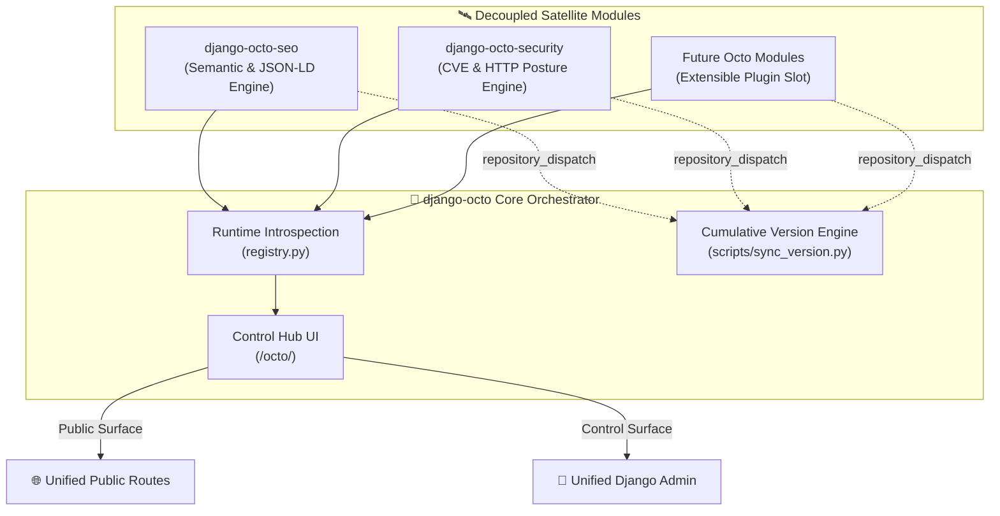

[](LICENSE)
[](https://python.org)
[](https://djangoproject.com)
[](https://astral.sh)

[](https://djangopackages.org/packages/p/django_octo/)
[](https://github.com/jeanpmodev/django_octo/blob/main/TESTING.md)
[](https://github.com/jeanpmodev/django_octo/actions/workflows/ci.yml)
[](https://peps.python.org/pep-0008/)
[](https://pypi.org/project/django-octo/#provenance)
[](https://security.snyk.io/package/pip/django-octo)
[](https://github.com/jeanpmodev/django_octo/actions/workflows/security.yml)
[](https://badge.socket.dev/pypi/package/django-octo/0.1.10?artifact_id=tar-gz)

**django_octo** is the modular core orchestrator for the **Django-Octo** framework ecosystem. It unifies decoupled runtime modules under a single installation entrypoint, providing automated environment discovery, live Dual-Channel observability, and event-driven cumulative versioning.

Designed to remain completely agnostic to domain logic, this core hub dynamically detects active satellite modules installed in the runtime environment (`importlib.util.find_spec` + `importlib.metadata`) and mounts their administrative and public surfaces without manual wiring or tight coupling.

---

##  Key Architectural Features

- **Zero-Config Environment Auto-Discovery:** Exposes `get_installed_octo_apps()` and dynamic URL mounting (`include("django_octo.urls")`), automatically registering only the satellite modules present in the active virtual environment.
- **Automated Control Hub (`/octo/`):** Built-in zero-dependency observability dashboard that introspects installed modules, displays live semantic versions, and bridges direct access between public channels and the Django Admin panel.
- **Event-Driven Cumulative Versioning:** Driven by `repository_dispatch` webhooks from satellite CI/CD pipelines. Every release published in a satellite module automatically increments the core version queue, updates `CHANGELOG.md`, validates cross-module coupling tests, and publishes a verified release to PyPI via OIDC Trusted Publishing.
- **Rye Environment Integration:** Fully integrated with the Rust-based Python package manager for deterministic dependency locking across the entire ecosystem.

---

##  Ecosystem Architecture & Dual-Channel Topology



---

##  Orchestrated Ecosystem 

| Module Package | Architectural Role | Public Surface | Control Surface |
| :--- | :--- | :--- | :--- |
| **`django-octo`** | Core Orchestrator & Runtime Hub | `/octo/` | Unified `INSTALLED_APPS` & `urls.py` |
| **[`django-octo-seo`](https://github.com/jeanpmodev/django_octo_seo)** | 8-Layer Semantic & JSON-LD Engine | `/seo-demo/` | `/admin/` (SEO Models) |
| **[`django-octo-security`](https://github.com/jeanpmodev/django_octo_security))** | Zero-Dependency CVE & HTTP Posture | `/security-audit/` | `/admin/` (CVE Checker) |

---

##  Installation & Quick Start (PyPI)

Install the entire unified ecosystem into any modern Django (`>=6.1.2`) and Python (`>=3.12`) project using **pip** or **Rye**:

### 1. Install Core Package
```bash
pip install django-octo
```
Or using the Rust-backed **Rye** package manager:
```bash
rye add django-octo
```

### 2. Auto-Register Apps & Migrate
Use `get_installed_octo_apps()` in your `settings.py` to automatically load the orchestrator alongside every detected satellite module:
```python
from django_octo import get_installed_octo_apps

INSTALLED_APPS = [
    "django.contrib.admin",
    "django.contrib.auth",
    "django.contrib.contenttypes",
    "django.contrib.sessions",
    "django.contrib.messages",
    "django.contrib.staticfiles",
    *get_installed_octo_apps(),
]
```
Apply all unified database migrations in a single pass:
```bash
python3 manage.py migrate
```

### 3. Mount the Unified Router
Include `django_octo.urls` in your root `urls.py` to expose the Control Hub and all active module endpoints simultaneously:
```python
from django.contrib import admin
from django.urls import include, path

urlpatterns = [
    path("admin/", admin.site.urls),
    path("", include("django_octo.urls")),
]
```
Start the server (`python3 manage.py runserver`) and navigate to **`http://127.0.0.1:8000/`** to inspect the live Control Hub.

---

##  Local Sandbox & Development Setup (Using Rye)

```bash
git clone https://github.com/jeanpmodev/django_octo/
cd django_octo
rye sync
rye test
```

---

##  License & Ecosystem Blueprint

Distributed under the permissive terms of the **MIT License**.
